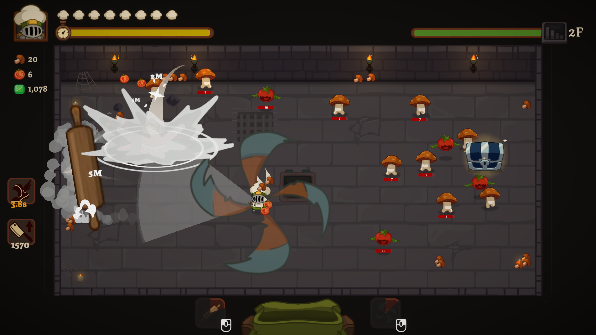

<div align="center">

# Ability Clicker

<a href="https://www.python.org"></a>
<a href="https://opensource.org/licenses/MIT"></a>

A lightweight Python automation utility that monitors on-screen ability icons

<br/>



</div>

## What it does

- Watches one small screen region (ROI) per ability, by default a thin strip along the top edge of the icon's border.
- Converts that region to HSV and measures what fraction of its pixels fall inside the "ready" color range.
- When that fraction reaches `min_ratio` (default 60%), the ability counts as **ready** and its mapped mouse button is pressed: the first ability presses **LMB**, the second **RMB**.
- Keeps pressing while the ability stays ready, at most once per `min_interval` per ability, polling at roughly 100 Hz with fast `mss` captures of only the ROIs.
- Includes `--dry` mode (detect and print, no clicking) and `--pick` mode (drag a box over an icon to get its ROI and a suggested HSV range).

## Requirements

- Windows (tested on Windows only)
- Python 3.10+
- [`opencv-python`](https://pypi.org/project/opencv-python/) (the regular build, not `-headless`: `--pick` opens a window)
- [`numpy`](https://pypi.org/project/numpy/)
- [`mss`](https://pypi.org/project/mss/) **10.2 or newer** (the script imports the `MSS` class, which older releases don't have)
- [`pynput`](https://pypi.org/project/pynput/)

To install the dependencies with pip:

```bash
pip install opencv-python numpy mss pynput
```

Or with conda:

```bash
conda install -c conda-forge opencv numpy python-mss pynput
```

> **Note:** on conda-forge the package called `mss` is a different project. The screen-capture library is published there as **`python-mss`**.
>
> If you get `ImportError: cannot import name 'MSS'`, your `mss` is too old.
>

## Usage

```bash
python ability_clicker.py --pick   # drag boxes over icons, prints ROI + HSV values
python ability_clicker.py --dry    # detect only, never clicks (for tuning)
python ability_clicker.py          # run for real
```

1. Launch the game in **borderless / windowed fullscreen** (exclusive fullscreen can produce black screen captures).
2. Put both abilities in their **ready** state and run `--pick`. Drag a box over each icon's border and press **Enter** (**C** skips an icon). Copy the printed `roi=(...)` values into `default_abilities()`.
3. Run `--dry`, use your abilities, and check that `cooldown` → `READY` is printed at the right moments.
4. Run the script without flags. Press **F8** to pause / resume and **F9** to quit.

## Configuration

Timing constants (`POLL_INTERVAL`, `HOLD_TIME`) are at the top of `ability_clicker.py`. Per-ability settings are in `default_abilities()`.
 
| Setting | Meaning |
| --- | --- |
| `roi` | `(left, top, width, height)` of the watched region, in screen pixels |
| `hsv_lower` / `hsv_upper` | "Ready" color range in OpenCV HSV (H 0–179, S 0–255, V 0–255) |
| `min_ratio` | Fraction of ROI pixels that must match to count as ready (default `0.6`) |
| `min_interval` | Minimum seconds between two presses of the same ability (default `0.08`) |
| `POLL_INTERVAL` | Seconds between screen checks (default `0.01`) |
| `HOLD_TIME` | Seconds each click is held down (default `0.02`, some games miss instant clicks) |
 
The default color range targets a bright cream/gold icon border. A V (brightness) lower bound of about 130 excludes the dark cooldown state, including its red sweep animation.

## Testing

ROI coordinates and colors were calibrated on a **1920x1080** screenshot of the game. Successfully used in **Chef Knight**. Other resolutions or HUD scales need new ROIs — use `--pick`.

## Notes

- ROI coordinates are absolute screen pixels for the **primary monitor**, so they depend on resolution, HUD scale and window position. `--pick` also captures the primary monitor only.
- In `--dry` mode a line is printed only when an ability's state **changes**, starting from `cooldown`. If nothing is ever printed, the ROI or the color range most likely doesn't match what is on screen.
- Choose an ROI over a part of the icon that changes color cleanly (such as the border), and avoid areas with cooldown numbers or sweeping overlays.
- If the game ignores the simulated clicks, try running the script as administrator; if that doesn't help, replace `pynput` with `pydirectinput`.
- Automated input may violate the terms of service of online games and can be flagged by anti-cheat systems. Use it in single-player games or where it is allowed.

## License

This project is licensed under the [MIT License](LICENSE).